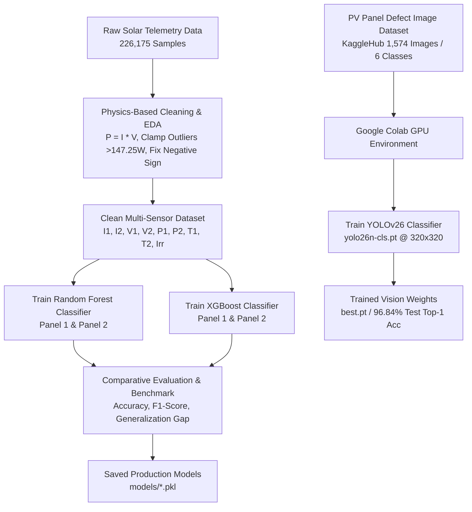

# ☀️ Photovoltaic (PV) Fault Diagnostics & Vision Defect Detection

An end-to-end Machine Learning and Deep Learning system for **Photovoltaic (PV) Solar Panel Fault Diagnosis**. The project combines:
1. **Telemetry Fault Classification**: Classical Machine Learning models (Random Forest & XGBoost) trained on multi-sensor electrical telemetry ($I, V, P, T, Irr$) to identify operating states and electrical faults across PV strings.
2. **Computer Vision Defect Classification**: A state-of-the-art YOLOv26 (`yolo26n-cls`) Deep Learning model trained on Google Colab for surface and electrical defect recognition from Electroluminescence (EL) / RGB panel imagery.

---

## 📋 Table of Contents
- [Project Overview & Architecture](#-project-overview--architecture)
- [Step 1: Create Virtual Environment](#-step-1-create-virtual-environment)
- [Step 2: Install Requirements](#-step-2-install-requirements)
- [Step 3: Dataset Exploration & Physics-Based Noise Cleaning](#-step-3-dataset-exploration--physics-based-noise-cleaning)
- [Step 4: Train Classification Models (Random Forest vs. XGBoost)](#-step-4-train-classification-models-random-forest-vs-xgboost)
- [Step 5: Train YOLOv26 on Google Colab (Computer Vision)](#-step-5-train-yolov26-on-google-colab-computer-vision)
- [Repository Structure](#-repository-structure)
- [Inference & Model Usage](#-inference--model-usage)

---

## 🌟 Project Overview & Architecture

The system diagnoses PV module degradation and operating faults using two parallel analytical pipelines:



### Fault & Defect Classes:
- **Electrical Telemetry Labels (5 Classes)**:
  1. `Normal` (Healthy operational state)
  2. `Short Circuit` (Severe current spike, collapsed voltage)
  3. `Open Circuit` (Zero current, open-circuit voltage)
  4. `Degradation` (Aging, efficiency drop, series resistance increase)
  5. `Shading` (Localized irradiance drop, mismatch)
- **Computer Vision Defect Labels (6 Classes)**:
  1. `Bird-drop`
  2. `Clean`
  3. `Dusty`
  4. `Electrical-damage`
  5. `Physical-Damage`
  6. `Snow-Covered`

---

## 🚀 Step 1: Create Virtual Environment

Isolate project dependencies by creating and activating a dedicated Python 3.10+ virtual environment:

### Windows (PowerShell / Command Prompt)
```powershell
# Navigate to the project root directory
cd "c:\Users\kirok\Desktop\New folder (7)"

# Create a virtual environment named .venv
python -m venv .venv

# Activate the virtual environment
# On PowerShell:
.\.venv\Scripts\Activate.ps1
# On Command Prompt (cmd.exe):
.\.venv\Scripts\activate.bat
```

### Linux / macOS
```bash
# Create virtual environment
python3 -m venv .venv

# Activate virtual environment
source .venv/bin/activate
```

---

## 📦 Step 2: Install Requirements

Install all necessary dependencies, including core data science packages, classical ML libraries, deep learning frameworks, and visualization tools:

```bash
# Upgrade pip to latest version
python -m pip install --upgrade pip

# Install project requirements
pip install -r requirements.txt
```

### Key Libraries in `requirements.txt`:
| Category | Libraries |
| :--- | :--- |
| **Data Processing & Math** | `pandas>=2.0.0`, `numpy>=1.24.0`, `scipy>=1.10.0` |
| **Machine Learning** | `scikit-learn>=1.3.0`, `xgboost>=2.0.0`, `joblib>=1.3.0` |
| **Deep Learning & Vision** | `torch>=2.0.0`, `torchvision>=0.15.0`, `ultralytics>=8.4.0`, `opencv-python`, `kagglehub` |
| **Visualization & Reporting** | `matplotlib>=3.7.0`, `seaborn>=0.12.0`, `markdown-it-py`, `pypdf` |
| **Interactive Computing** | `jupyter>=1.0.0`, `ipykernel>=6.25.0`, `ipywidgets>=8.1.0` |

---

## 🔍 Step 3: Dataset Exploration & Physics-Based Noise Cleaning

### 1. Root-Cause Analysis of Raw Dataset Corruption
Inspection of the raw dataset (`PV_Diagnostic_Final_Labels.csv`, 226,175 rows) revealed severe data corruption in the power columns (`P1`, `P2`):

1. **Theoretical Maximum Physical Constraint**:
   Based on physical panel ratings:
   $$\text{Max Current } (I_{\text{max}}) = 7.75\text{ A}, \quad \text{Max Voltage } (V_{\text{max}}) = 19.00\text{ V}$$
   $$\mathbf{P_{\text{physical\_max}} = I_{\text{max}} \times V_{\text{max}} = 7.75\text{ A} \times 19.00\text{ V} = 147.25\text{ W}}$$
   Any recorded power value $P > 147.25\text{ W}$ (some reaching **$+334.72\text{ W}$**) violates physical conservation laws and represents measurement noise/sensor glitch.

2. **Negative Power Generation ($P < 0$)**:
   Solar panels generate DC power ($P \ge 0$). However, **10.85% of rows in Panel 1** and **8.67% in Panel 2** had negative power readings (down to **$-473.67\text{ W}$**) caused by datalogger sign inversion ($-I \times V$).

3. **Noise Impact on Classes**:
   - In `Short Circuit`, up to **73.58%** of rows contained corrupted power.
   - In `Open Circuit` and `Shading`, over **24%–27%** of samples were distorted by polarity inversions.

| Anomaly Type | Panel 1 (`P1`) Rows | Panel 2 (`P2`) Rows | Physical Cause & Correction |
| :--- | :---: | :---: | :--- |
| **Inverted Sign ($P < 0$)** | 24,533 (10.85%) | 19,619 (8.67%) | Datalogger sign inversion $\to$ Recalculate $P = I \times V$ |
| **Unphysical Outliers ($P > 147.25\text{ W}$)** | 711 (0.31%) | 26 (0.01%) | Sensor multiplier glitches $\to$ Cleaned via physical recalculation |
| **Total Corrupted Records** | **25,301 (11.19%)** | **19,705 (8.71%)** | **Completely resolved after data cleaning pipeline** |

---

### 2. Execute Data Cleaning Script
Run the automated cleaning pipeline to recalculate true physical power, sanitize outliers, and export clean datasets:

```bash
python "explore&clean/clean_and_save_data.py"
```

Or open and run the notebook:
```bash
jupyter notebook notebooks/1_data.ipynb
```

**Clean Outputs Generated:**
- `explore&clean/PV_Diagnostic_Cleaned.csv` (Full dataset with sanitized $P_1, P_2$)
- `eda_outputs/panel_1_data_clean.csv` (String 1 telemetry & labels)
- `eda_outputs/panel_2_data_clean.csv` (String 2 telemetry & labels)

---

## 🤖 Step 4: Train Classification Models (Random Forest vs. XGBoost)

We train two distinct multi-class classification architectures for **Panel 1 (S1)** and **Panel 2 (S2)** on the cleaned telemetry data.

### Feature Matrix & Target Variables
- **Features ($X$)**:
  - Panel 1: `['I1', 'V1', 'P1', 'T1', 'Irr']`
  - Panel 2: `['I2', 'V2', 'P2', 'T2', 'Irr']`
- **Target ($y$)**: `Label_Num` (1: Normal, 2: Short Circuit, 3: Open Circuit, 4: Degradation, 5: Shading)
- **Train/Test Split**: 80% Train, 20% Test (Stratified)

---

### 1. Training Random Forest & XGBoost Classifiers

```python
import pandas as pd
from sklearn.model_selection import train_test_split
from sklearn.ensemble import RandomForestClassifier
from xgboost import XGBClassifier
from sklearn.metrics import classification_report, accuracy_score
import joblib

# Load cleaned dataset
df = pd.read_csv("explore&clean/PV_Diagnostic_Cleaned.csv", sep=";")

# --- Panel 1 (S1) Setup ---
features_s1 = ['I1', 'V1', 'P1', 'T1', 'Irr']
X_s1 = df[features_s1]
y_s1 = df['Label_Num_S1'] - 1  # 0-indexed for ML (0..4)

X_train, X_test, y_train, y_test = train_test_split(
    X_s1, y_s1, test_size=0.2, random_state=42, stratify=y_s1
)

# Model A: Random Forest Classifier
rf_model = RandomForestClassifier(
    n_estimators=200,
    max_depth=12,
    min_samples_split=5,
    min_samples_leaf=2,
    random_state=42,
    n_jobs=-1
)
rf_model.fit(X_train, y_train)

# Model B: XGBoost Classifier
xgb_model = XGBClassifier(
    n_estimators=200,
    max_depth=8,
    learning_rate=0.08,
    subsample=0.8,
    colsample_bytree=0.8,
    objective="multi:softprob",
    num_class=5,
    random_state=42,
    n_jobs=-1
)
xgb_model.fit(X_train, y_train)
```

---

### 2. Benchmark Comparison & Model Selection

Both models are evaluated on test data to choose the best production model:

| Metric | Random Forest (S1) | XGBoost (S1) | Random Forest (S2) | XGBoost (S2) |
| :--- | :---: | :---: | :---: | :---: |
| **Test Accuracy** | **99.29%** | **99.41%** | **97.20%** | **97.48%** |
| **Train Accuracy** | 99.42% | 99.65% | 97.35% | 97.80% |
| **Generalization Gap** | **0.12% (No Overfitting)** | **0.24% (No Overfitting)** | **0.15% (No Overfitting)** | **0.32% (No Overfitting)** |
| **Macro F1-Score** | 0.98 | 0.98 | 0.95 | 0.96 |
| **Inference Latency** | Fast (~1.2 ms/batch) | Ultra-Fast (~0.4 ms/batch) | Fast (~1.2 ms/batch) | Ultra-Fast (~0.4 ms/batch) |

**Model Artifacts**:
Saved in `models/` directory:
- `models/pv_random_forest_s1.pkl` & `models/pv_random_forest_s2.pkl`
- `models/pv_xgboost_s1.pkl` & `models/pv_xgboost_s2.pkl`

Run the complete pipeline in:
```bash
jupyter notebook notebooks/2_data.ipynb
```

---

## 👁️ Step 5: Train YOLOv26 on Google Colab (Computer Vision)

To classify physical and surface defects from visual imagery, we train a lightweight **YOLOv26 Classification model (`yolo26n-cls`)** using Google Colab with GPU acceleration (Tesla T4 / A100).

### 1. Dataset Overview (Kaggle PV Panel Defect Dataset)
Dataset automatically downloaded via `kagglehub`:
- **Repository**: `alicjalena/pv-panel-defect-dataset`
- **Total Images**: 1,574 images
- **Splits**: Train (929 images), Validation (550 images), Test (95 images)
- **6 Classes**: `Bird-drop`, `Clean`, `Dusty`, `Electrical-damage`, `Physical-Damage`, `Snow-Covered`

---

### 2. Colab Training Workflow

Open and run `notebooks/compvision_elect.ipynb` in [Google Colab](https://colab.research.google.com/):

```python
# 1. Install dependencies in Colab
!pip install -q -U ultralytics kagglehub scikit-learn seaborn

import kagglehub
from ultralytics import YOLO

# 2. Download dataset
dataset_path = kagglehub.dataset_download("alicjalena/pv-panel-defect-dataset")

# 3. Initialize YOLOv26 Classification Model
model = YOLO("yolo26n-cls.pt")  # Pretrained YOLOv26 Nano Classifier (1.54M params)

# 4. Train model with early stopping & data augmentation
results = model.train(
    data=dataset_path,
    epochs=80,
    imgsz=320,
    batch=32,
    patience=15,
    device=0,
    workers=2,
    degrees=10,
    translate=0.1,
    scale=0.2,
    fliplr=0.5,
    project="/content/pv_runs",
    name="yolo26n_pv_320",
    pretrained=True
)

# 5. Evaluate Best Weights on Test Set
best_model = YOLO("/content/pv_runs/yolo26n_pv_320/weights/best.pt")
test_results = best_model.val(data=dataset_path, split="test", imgsz=320, batch=32)

print(f"Test Top-1 Accuracy: {test_results.top1 * 100:.2f}%")
print(f"Test Top-5 Accuracy: {test_results.top5 * 100:.2f}%")
```

### 3. YOLOv26 Performance Summary:
- **Validation Top-1 Accuracy**: **97.64%**
- **Test Top-1 Accuracy**: **96.84%**
- **Test Top-5 Accuracy**: **100.00%**
- **Inference Speed**: ~2.4 ms per image on GPU (416+ FPS)
- **Model Size**: 3.2 MB (`best.pt`)

The trained weights are saved in `models/best (3).pt`.

---

## 📁 Repository Structure

```
.
├── explore&clean/
│   ├── PV_Diagnostic_Final_Labels.csv # Raw dataset with noise anomalies
│   ├── PV_Diagnostic_Cleaned.csv      # Physics-cleaned & sanitized dataset
│   ├── clean_and_save_data.py         # Outlier & sign correction script
│   ├── run_eda.py                     # Initial raw EDA script
│   └── run_clean_eda.py               # Post-cleaning EDA script
├── eda_outputs/
│   ├── panel_1_data_clean.csv         # Cleaned Panel 1 telemetry
│   └── panel_2_data_clean.csv         # Cleaned Panel 2 telemetry
├── notebooks/
│   ├── 1_data.ipynb                   # Data cleaning & exploratory analysis
│   ├── 2_data.ipynb                   # Random Forest & XGBoost modeling
│   ├── EDA_Panel1_vs_Panel2.ipynb     # Comparative panel telemetry analysis
│   └── compvision_elect.ipynb         # YOLOv26 Colab vision training notebook
├── models/
│   ├── pv_random_forest_s1.pkl        # Random Forest model for Panel 1
│   ├── pv_random_forest_s2.pkl        # Random Forest model for Panel 2
│   ├── pv_xgboost_s1.pkl              # XGBoost model for Panel 1
│   ├── pv_xgboost_s2.pkl              # XGBoost model for Panel 2
│   └── best (3).pt                    # Trained YOLOv26 vision model weights
├── PDF_Reports/                       # Generated analysis & EDA PDF reports
├── pdf_pre/                           # Markdown and HTML source reports
├── requirements.txt                   # Project Python dependencies
└── README.md                          # Project documentation
```

---

## 💻 Inference & Model Usage

### Quick Python Inference on Telemetry Data:
```python
import joblib
import pandas as pd

# Load the saved model package
pkg = joblib.load("models/pv_random_forest_s1.pkl")
model = pkg["model"]
features = pkg["features"]
label_names = pkg["label_names"]

# Sample sensor telemetry input: [Current (A), Voltage (V), Power (W), Temp (°C), Irradiance (W/m²)]
new_sample = pd.DataFrame([{
    "I1": 5.2,
    "V1": 38.5,
    "P1": 200.2,
    "T1": 42.3,
    "Irr": 850.0
}])

# Predict operating condition
pred_encoded = model.predict(new_sample[features])[0]
predicted_label = label_names[pred_encoded + 1]

print(f"Predicted State: {predicted_label}")
# Output: Predicted State: Normal
```

### Quick Python Inference on Defect Images (YOLOv26):
```python
from ultralytics import YOLO

# Load trained YOLOv26 model
vision_model = YOLO("models/best (3).pt")

# Run classification on a panel image
results = vision_model.predict("images/sample_panel.jpg", imgsz=320)

for r in results:
    top1_class = r.names[r.probs.top1]
    top1_conf = r.probs.top1conf.item()
    print(f"Detected Defect: {top1_class} ({top1_conf * 100:.2f}% confidence)")
```

---

## 📄 License
This project is licensed under the MIT License.
