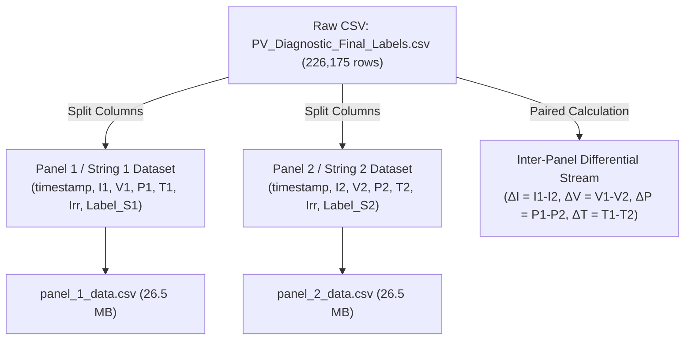

# ☀️ Solar PV Fault Diagnostics: Panel 1 vs. Panel 2 Exploratory Data Analysis (EDA)

This report provides a comprehensive exploratory analysis of the photovoltaic diagnostic dataset ([PV_Diagnostic_Final_Labels.csv](file:///c:/Users/kirok/Desktop/New%20folder%20%287%29/PV_Diagnostic_Final_Labels.csv)), systematically comparing **Panel 1 (String 1)** and **Panel 2 (String 2)**.

---

## 1. Dataset Overview & Separation Architecture

The dataset contains high-frequency time-series measurements collected between **January 10, 2026** and **January 23, 2026** (226,175 records).

### Generated Files & Artifacts
- **Jupyter Notebook**: [EDA_Panel1_vs_Panel2.ipynb](file:///c:/Users/kirok/Desktop/New%20folder%20%287%29/EDA_Panel1_vs_Panel2.ipynb)
- **Standalone Runner**: [run_eda.py](file:///c:/Users/kirok/Desktop/New%20folder%20%287%29/run_eda.py)
- **Separated Panel 1 Data**: [panel_1_data.csv](file:///c:/Users/kirok/Desktop/New%20folder%20%287%29/eda_outputs/panel_1_data.csv)
- **Separated Panel 2 Data**: [panel_2_data.csv](file:///c:/Users/kirok/Desktop/New%20folder%20%287%29/eda_outputs/panel_2_data.csv)

---

## 2. Fault Class Distribution (Panel 1 vs Panel 2)

Both panels record 5 operational states / fault types:

| Fault Label | Numeric Code | Panel 1 Count | Panel 1 Share | Panel 2 Count | Panel 2 Share |
| :--- | :---: | :---: | :---: | :---: | :---: |
| **Degradation** | `4` | 103,885 | 45.93% | 105,672 | 46.72% |
| **Open Circuit** | `3` | 58,171 | 25.72% | 52,104 | 23.04% |
| **Normal** | `1` | 47,303 | 20.91% | 51,864 | 22.93% |
| **Shading** | `5` | 16,763 | 7.41% | 16,402 | 7.25% |
| **Short Circuit** | `2` | 53 | 0.02% | 133 | 0.06% |
| **Total** | — | **226,175** | **100.0%** | **226,175** | **100.0%** |

> [!WARNING]
> **Severe Class Imbalance**: `Short Circuit` makes up less than 0.1% of the records in both panels. When training classification models (e.g., Random Forest, XGBoost, or Neural Networks), apply techniques like SMOTE, class-weighting (`class_weight='balanced'`), or focal loss.

---

## 3. Physical Parameters & Summary Statistics

### Panel 1 Electrical & Thermal Summary
| Metric | Current $I_1$ (A) | Voltage $V_1$ (V) | Power $P_1$ (W) | Temp $T_1$ (°C) | Irradiance $Irr$ ($W/m^2$) |
| :--- | :---: | :---: | :---: | :---: | :---: |
| **Mean** | 1.669 A | 15.963 V | 26.260 W | 39.861 °C | 599.581 $W/m^2$ |
| **Std Dev** | 1.731 A | 3.729 V | 29.541 W | 5.103 °C | 266.939 $W/m^2$ |
| **Min** | 0.000 A | 0.000 V | -1.542 W | 14.860 °C | 0.000 $W/m^2$ |
| **25% (Q1)** | 0.116 A | 14.714 V | 1.488 W | 36.435 °C | 437.000 $W/m^2$ |
| **50% (Median)**| 1.124 A | 16.068 V | 15.776 W | 40.688 °C | 632.000 $W/m^2$ |
| **75% (Q3)** | 3.052 A | 18.787 V | 49.758 W | 44.667 °C | 827.000 $W/m^2$ |
| **Max** | 7.750 A | 19.000 V | 334.724 W | 45.000 °C | 1154.000 $W/m^2$ |

### Panel 2 Electrical & Thermal Summary
| Metric | Current $I_2$ (A) | Voltage $V_2$ (V) | Power $P_2$ (W) | Temp $T_2$ (°C) | Irradiance $Irr$ ($W/m^2$) |
| :--- | :---: | :---: | :---: | :---: | :---: |
| **Mean** | 1.680 A | 15.805 V | 25.965 W | 39.686 °C | 599.581 $W/m^2$ |
| **Std Dev** | 1.709 A | 3.981 V | 26.990 W | 4.990 °C | 266.939 $W/m^2$ |
| **Min** | 0.000 A | 0.000 V | -1.332 W | 15.020 °C | 0.000 $W/m^2$ |
| **25% (Q1)** | 0.176 A | 14.498 V | 2.274 W | 36.315 °C | 437.000 $W/m^2$ |
| **50% (Median)**| 0.999 A | 16.033 V | 13.156 W | 40.756 °C | 632.000 $W/m^2$ |
| **75% (Q3)** | 3.048 A | 18.826 V | 47.293 W | 44.156 °C | 827.000 $W/m^2$ |
| **Max** | 7.750 A | 18.972 V | 232.153 W | 45.000 °C | 1154.000 $W/m^2$ |

---

## 4. Electrical Signatures by Fault Type

### Mean Physical Parameters Across Faults
| Panel | Fault Class | Current (A) | Voltage (V) | Power (W) | Temp (°C) | Irradiance ($W/m^2$) |
| :---: | :--- | :---: | :---: | :---: | :---: | :---: |
| **Panel 1** | **Normal** | 2.813 | 12.301 | 42.082 | 38.687 | 596.50 |
| | **Degradation** | 2.284 | 16.599 | 37.313 | 40.054 | 604.11 |
| | **Open Circuit** | 0.078 | 18.821 | 0.776 | 41.729 | 627.75 |
| | **Shading** | 0.146 | 12.493 | 1.631 | 35.512 | 483.12 |
| | **Short Circuit** | 4.714 | 0.137 | 0.554 | 35.123 | 389.09 |
| **Panel 2** | **Normal** | 2.742 | 12.007 | 39.283 | 39.762 | 597.37 |
| | **Degradation** | 2.159 | 16.668 | 35.097 | 39.424 | 606.71 |
| | **Open Circuit** | 0.121 | 18.832 | 1.715 | 41.566 | 625.11 |
| | **Shading** | 0.180 | 12.757 | 2.251 | 35.193 | 481.69 |
| | **Short Circuit** | 2.893 | 0.610 | 0.938 | 34.911 | 333.83 |

### Key Fault Identification Rules:
1. **Short Circuit**: Very high Current ($I \uparrow$), near-zero Voltage ($V \approx 0\text{ V}$), near-zero Power ($P \approx 0\text{ W}$).
2. **Open Circuit**: Near-zero Current ($I \approx 0\text{ A}$), Maximum Open-Circuit Voltage ($V_{oc} \approx 18.8\text{ V}$), zero Power ($P \approx 0\text{ W}$).
3. **Shading**: Low Current ($I \approx 0.15\text{ A}$), moderate Voltage, lower operating temperature ($35^\circ\text{C}$).
4. **Degradation**: Moderate Current loss and elevated voltage operating point with lower efficiency.

---

## 5. Correlation Analysis (Panel 1 vs Panel 2)

The correlation structure between internal electrical variables ($I, V, P$) and environmental conditions ($Irr, T$) is identical across both panels:

| Pairwise Relationship | Panel 1 Correlation ($r$) | Panel 2 Correlation ($r$) | Physical Meaning |
| :--- | :---: | :---: | :--- |
| **Power vs Current** | **+0.90** | **+0.89** | Power production is predominantly current-driven. |
| **Irradiance vs Current** | **+0.68** | **+0.68** | Solar irradiance directly governs photocurrent generation. |
| **Irradiance vs Power** | **+0.64** | **+0.64** | Direct proportional power generation from solar flux. |
| **Voltage vs Current** | **-0.64** | **-0.67** | Standard PV operating characteristic slope ($I-V$ trade-off). |
| **Voltage vs Power** | **-0.27** | **-0.31** | Operating voltage drops slightly at high load/current. |

---

## 6. Inter-Panel Differential Diagnostics ($\Delta$)

When both panels operate in the same array under identical irradiance, differential metrics ($\Delta = \text{Panel}_1 - \text{Panel}_2$) immediately expose localized anomalies:

$$\Delta I = I_1 - I_2, \quad \Delta V = V_1 - V_2, \quad \Delta P = P_1 - P_2, \quad \Delta T = T_1 - T_2$$

### Cross-Tabulation: Panel 1 Fault vs. Panel 2 Fault
| Panel 1 \ Panel 2 | Degradation | Normal | Open Circuit | Shading | Short Circuit | Total |
| :--- | :---: | :---: | :---: | :---: | :---: | :---: |
| **Degradation** | **75,539** | 26,437 | 1,894 | 0 | 15 | 103,885 |
| **Normal** | 23,103 | **21,845** | 2,165 | 77 | 113 | 47,303 |
| **Open Circuit** | 6,541 | 2,660 | **48,970** | 0 | 0 | 58,171 |
| **Shading** | 489 | 874 | 0 | **15,400** | 0 | 16,763 |
| **Short Circuit** | 0 | 48 | 0 | 0 | **5** | 53 |
| **Total** | 105,672 | 51,864 | 52,104 | 16,402 | 133 | 226,175 |

> [!TIP]
> **Key Finding**: When one panel experiences `Shading` (16,763 events in P1), Panel 2 is also in `Shading` **91.9%** of the time (15,400 events). However, `Open Circuit` and `Degradation` frequently occur on one panel while the other remains `Normal` or undergoes a different state, highlighting the utility of differential panel features for independent fault detection.
